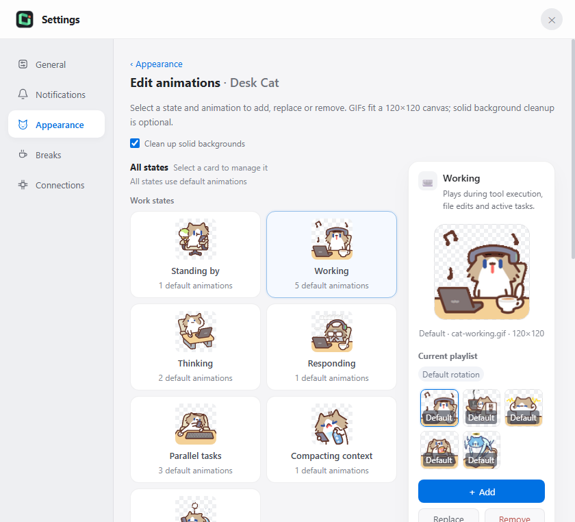
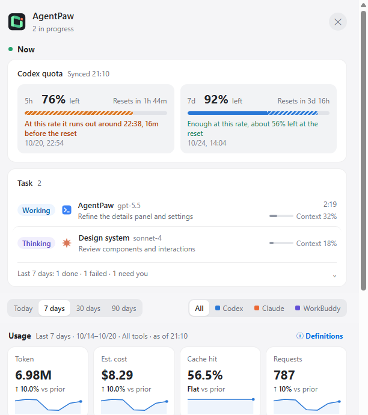

<div align="center">
  
  <h1>AgentPaw</h1>
  <p><strong>A desktop pet that keeps an eye on your AI coding agents.</strong></p>
  <p>It raises a paw when Claude Code needs approval, shows your Codex quota and token usage at a glance,<br>and reminds you to drink water — on Windows, with any GIF as your pet.</p>
  <p>Works with <strong>Codex</strong> · <strong>Claude Code</strong> · <strong>WorkBuddy</strong> · <strong>opencode</strong></p>

  <p>
    <a href="https://github.com/vista-zhangg/agentpaw/releases/latest"></a>
  </p>
  <p>
    <a href="README.md">English</a> ·
    <a href="README_ZH_HANS.md">简体中文</a> ·
    <a href="README_ZH_HANT.md">繁體中文</a> ·
    <a href="README_FR.md">Français</a>
  </p>
  <p>
    <a href="https://github.com/vista-zhangg/agentpaw/actions/workflows/ci.yml"></a>
    
    <a href="LICENSE"></a>
    
  </p>
</div>

<p align="center"><br>
<sub>Demo recorded with a character pack made from the AgentPaw icon. Built-in characters and your own GIFs work the same way.</sub></p>

<table>
  <tr>
    <td align="center" valign="bottom" width="33%"><br><sub><strong>Quick view</strong> — click the pet</sub></td>
    <td align="center" valign="bottom" width="33%"><br><sub><strong>Approve from the pet</strong> — Enter allows</sub></td>
    <td align="center" valign="bottom" width="33%"><br><sub><strong>Codex quota</strong> — with run-out forecast</sub></td>
  </tr>
</table>

## Why AgentPaw

- **Stop checking the terminal.** The pet works while your agent works, raises a paw when it needs you, and celebrates when a turn is done. Several sessions across four tools show up in one place.
- **Approve without switching windows.** Allow or deny Claude Code requests right on the pet, and review plans as formatted Markdown before approving them.
- **Know your quota before it runs out.** Codex 5h / 7d quota, reset times and a run-out forecast — no need to open Codex. Token, cache and cost statistics cover every tool.
- **Make it yours.** Four built-in characters, or turn any GIF into a pet. Every state — working, thinking, waiting, done, error, sleeping — can use its own animations.

It also looks after you: water, stretch and eye-rest reminders follow your time at the computer, whether or not an AI task is running.

## Get started

1. Download `AgentPaw-<version>-Windows-x64.exe` from the [latest release](https://github.com/vista-zhangg/agentpaw/releases/latest) and run it.
2. The installer is not commercially code-signed yet. If Windows SmartScreen appears, choose **More info → Run anyway**.
3. That's it. AgentPaw detects the agents you already use and connects to them automatically; no configuration is needed. Updates install from inside the app.
4. Want to see it in action first? Right-click the pet and choose **Play a demo**.

> [!NOTE]
> AgentPaw supports **Windows x64 only**; macOS, Linux and Windows on ARM are not supported. The app UI is available in English, Simplified Chinese and Traditional Chinese.

## Characters

Built-in characters include **Salary Cat**, **Milk Tea Mouse (BOBARAT)**, **Mimi Bee (小蜜蜂蜜蜜)** and **Line Dog (线条小狗 / Maltese)**. Milk Tea Mouse alone has 83 animations across 16 states, including sleep, doze and yawn.

| Salary Cat · Working | Milk Tea Mouse · Working | Mimi Bee · Greeting | Line Dog · Working |
| --- | --- | --- | --- |
|  |  |  |  |

<table>
  <tr>
    <td align="center"><br><strong>Working</strong><br><sub>A tool is running</sub></td>
    <td align="center"><br><strong>Thinking</strong><br><sub>The model is reasoning</sub></td>
    <td align="center"><br><strong>Parallel</strong><br><sub>Several tasks are active</sub></td>
    <td align="center"><br><strong>Permission</strong><br><sub>Your decision is required</sub></td>
  </tr>
  <tr>
    <td align="center"><br><strong>Completed</strong><br><sub>A turn has finished</sub></td>
    <td align="center"><br><strong>Error</strong><br><sub>A session needs attention</sub></td>
    <td align="center"><br><strong>Between tools</strong><br><sub>Waiting for the next event</sub></td>
    <td align="center"><br><strong>Resting</strong><br><sub>No active task</sub></td>
  </tr>
</table>

### Bring your own GIF

Open Settings → **Appearance**, then create a pet from a single idle GIF or [import a full character pack](docs/character-packs.md). For each state you can add rotating variants, replace or remove an item, or restore the defaults.

<p align="center"></p>

GIFs are fitted to a 120 × 120 canvas; transparent backgrounds are kept and a detached solid-color border is removed when that is safe. Limits: 12 MB, 2048 × 2048, 180 frames and 60 seconds per GIF, up to 20 custom animations per state. AgentPaw stores a processed copy in `~/.agentpaw/pet-assets` and never changes the source file. You are responsible for the rights to the GIFs you import.

## Usage at a glance

<p align="center"></p>

The details panel brings tokens, cache hit rate, context windows, models and reference costs from every tool together, with tool and period filters, daily and hourly charts, active hours and lifetime totals. Costs are estimates at public API prices, not your subscription bill.

<details>
<summary><strong>All features</strong></summary>

- **Status at a glance** — working, thinking, parallel tasks, compaction, permission waits, user input, completion, errors, breaks and sleep; background tasks and scheduled wakeups stay active until they actually clear.
- **Calmer notifications** — choose Standard or Needs attention only, combine completion notices, defer transient failures, and mute an agent or project while keeping permission cards available.
- **Quick view** — what needs you (approve on the spot), what is running with model, elapsed time and context use, recent sessions and the last 7 days. Finished tasks stay marked on the capsule until you open them. Follow, rename or mute a project in place.
- **Claude Code plan usage (optional)** — turn it on under Settings → Connections to see your 5h / 7d Pro or Max usage in the details panel, quick view and tray menu. It uses Claude Code's documented status line data, so it updates only when you run `claude` in a terminal; the Claude desktop app and IDE extensions may not run the status line, and then no usage appears. An existing status line keeps working.
- **Codex quota in the tray** — right-click the tray icon for the masked current account, 5h / 7d remaining quota, reset times and last update. Missing windows show `--`.
- **Integration health** — verify all four agents, then repair or remove AgentPaw-managed integrations from Settings.
- **Privacy mode** — one click in the right-click menu hides sensitive details while keeping essential state visible.
- **Breaks** — water, stretch and eye-rest reminders with their own intervals and snooze; skip for today; see today's usage, completed and skipped breaks.
- **Stays out of the way** — hides during fullscreen apps, quiet for 15 / 30 / 60 minutes or a custom duration, compact capsule mode, edge snapping, optional global shortcuts (off by default), auto-start.

</details>

## Supported agents

| Agent | Integration | External configuration | In-pet approval |
| --- | --- | --- | --- |
| Codex | Incremental local rollout JSONL reader; official App Server quota notifications | Does not modify Codex configuration or read credential files | Read-only alerts |
| Claude Code | Lifecycle hooks, transcript, and process data | Merge-safe AgentPaw hook install/uninstall | Supported |
| WorkBuddy | Hooks, transcripts, and usage fields | Installs a merge-safe hook only when WorkBuddy is detected | Read-only alerts |
| opencode | Official plugin mechanism, events, and usage file | Installs/removes one standalone plugin file | Read-only alerts |

On first launch AgentPaw only connects to tools the current Windows account already uses, and never creates configuration folders for agents it does not detect.

## Data and privacy

- Everything stays on your machine. Session data is read and processed locally; configuration and usage ledgers live in `~/.agentpaw/`.
- The local HTTP service binds to loopback only, and write endpoints require a fresh per-run token.
- The only download is the public price list from models.dev. Transcripts, permission contents and usage statistics are never uploaded.
- Codex quota is read through Codex's own App Server, which handles authentication. AgentPaw does not read `~/.codex/auth.json` or call ChatGPT web endpoints.
- Claude Code plan usage (off by default) comes only from the documented status line data; no Claude credentials are read.

See [Privacy and data boundaries](docs/PRIVACY.md) for the full policy.

## How it works

```text
Claude hooks ─────┐
Codex rollouts ───┼──> local server / watchers ──> adapter / core ──> pet + details panel
Codex logs ───────┤                                      └────────> unified usage ledger
WorkBuddy ────────┤
opencode plugin ──┤
Codex App Server ─────> tray context menu (5h / 7d) + low-quota bubble
```

The main process owns watcher lifecycles, the tray and windows. The backend state machine aggregates concurrent sessions, and renderers only receive a reduced status and event protocol. State vocabulary and priority are defined once in [`shared/states.js`](shared/states.js); see the [state machine specification](STATES.md).

## Documentation

- [User guide (Chinese)](docs/介绍.md)
- [Character packs](docs/character-packs.md)
- [Local development and packaging (Chinese)](docs/LOCAL_DEPLOYMENT.md)
- [Release process and compatibility policy](docs/RELEASE.md)
- [Contributing](CONTRIBUTING.md) · [Security policy](SECURITY.md)

## Origin and licensing

AgentPaw is an independent, free and non-profit open-source project, not affiliated with OpenAI or Anthropic. It is derived from [LLMPET](https://github.com/myunwang/LLMPET), with substantial work on Windows desktop behavior, multi-agent integrations, unified usage reporting, settings and project structure.

- Source code is released under the [MIT License](LICENSE); the root license retains the upstream `Copyright (c) 2026 myunwang` notice.
- Third-party character artwork is not covered by the MIT License and remains the property of its creators: Milk Tea Mouse by **Achi (阿翅)**, Mimi Bee by **花栗鼠发发**, Line Dog by **Moonlab Studio**. See the [credits overview](assets/CREDITS.md) and the notes for [Salary Cat](assets/cat/CREDITS.md), [Milk Tea Mouse](assets/characters/milktea-mouse/CREDITS.md), [Mimi Bee](assets/characters/mimi-bee/CREDITS.md) and [Line Dog](assets/characters/line-dog/CREDITS.md). No characters or downloads are sold.

## Contributing

Bug reports, Windows compatibility fixes, new agent integrations and character packs are welcome. Read [CONTRIBUTING.md](CONTRIBUTING.md) first, and report vulnerabilities privately as described in [SECURITY.md](SECURITY.md). If AgentPaw keeps you company, a ⭐ helps others find it.
