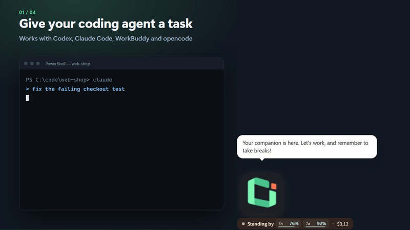
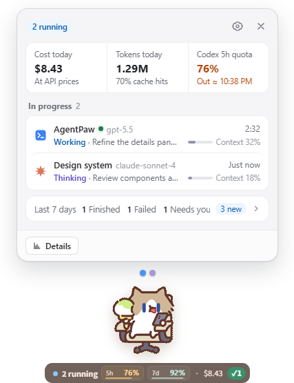
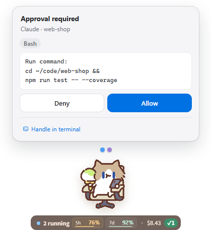
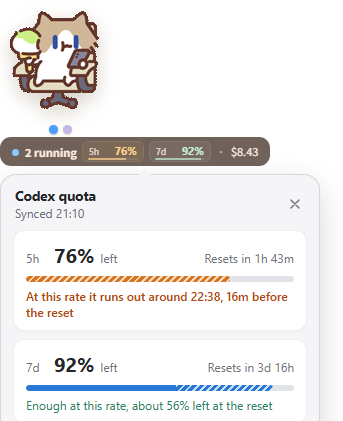

  
  <h1>AgentPaw</h1>
  
<strong>Un compagnon de bureau qui garde un œil sur vos agents de code IA.</strong>

  
Il lève la patte quand Claude Code attend une autorisation, affiche vos quotas Codex et votre consommation de tokens, et vous rappelle de boire un verre d'eau — sous Windows, avec n'importe quel GIF comme compagnon.

  
Compatible avec <strong>Codex</strong> · <strong>Claude Code</strong> · <strong>WorkBuddy</strong> · <strong>opencode</strong>

  

    
  

  

    <a href="README.md">English</a> ·
    <a href="README_ZH_HANS.md">简体中文</a> ·
    <a href="README_ZH_HANT.md">繁體中文</a> ·
    <a href="README_FR.md">Français</a>
  

  

    
    
    
    
  

 
Démo enregistrée avec un pack de personnage créé à partir de l'icône d'AgentPaw ; les personnages intégrés et vos propres GIF fonctionnent de la même façon.

<table>
  <tr>
    <td align="center" valign="bottom" width="33%"> <strong>Vue rapide</strong> — un clic sur le compagnon</td>
    <td align="center" valign="bottom" width="33%"> <strong>Autoriser sur place</strong> — Entrée autorise</td>
    <td align="center" valign="bottom" width="33%"> <strong>Quotas Codex</strong> — avec prévision</td>
  </tr>
</table>

Captures de l'interface en anglais ; l'application est disponible en anglais, chinois simplifié et chinois traditionnel.

## Pourquoi AgentPaw

- **Plus besoin de surveiller le terminal.** Le compagnon travaille quand votre agent travaille, lève la patte quand il a besoin de vous et vous prévient quand un tour est terminé. Les sessions de quatre outils sont réunies au même endroit.
- **Autoriser sans changer de fenêtre.** Autorisez ou refusez les demandes de Claude Code directement sur le compagnon ; les plans s'affichent en Markdown avant approbation.
- **Voir venir la fin du quota.** Quotas Codex 5h / 7j, heures de réinitialisation et prévision d'épuisement, sans ouvrir Codex ; statistiques de tokens, de cache et de coûts pour tous les outils.
- **Un compagnon à votre image.** Quatre personnages intégrés, ou n'importe quel GIF transformé en compagnon ; chaque état peut avoir ses propres animations.

Il prend aussi soin de vous : les rappels pour boire, s'étirer et reposer les yeux suivent votre temps devant l'écran, qu'une tâche IA soit en cours ou non.

## Démarrer

1. Téléchargez `AgentPaw-<version>-Windows-x64.exe` depuis la [dernière version publiée](https://github.com/vista-zhangg/agentpaw/releases/latest) et lancez-le.
2. L'installateur n'a pas encore de signature de code commerciale. Si SmartScreen s'affiche, choisissez **Informations complémentaires → Exécuter quand même**.
3. C'est tout. AgentPaw détecte les agents que vous utilisez déjà et s'y connecte automatiquement, sans configuration. Les mises à jour s'installent depuis l'application.
4. Envie de voir avant d'essayer ? Clic droit sur le compagnon, puis **Play a demo**.

> [!NOTE]
> AgentPaw prend en charge **Windows x64 uniquement** ; macOS, Linux et Windows sur ARM ne sont pas pris en charge.

## Personnages

Chat au travail, Milk Tea Mouse, Mimi Bee et Line Dog sont intégrés. Dans Paramètres → **Apparence**, créez votre propre personnage à partir d'un GIF d'attente ou importez un [pack de personnages](docs/character-packs.md) ; chaque état accepte des variantes, remplacements et une restauration des valeurs par défaut.

| Chat au travail | Milk Tea Mouse au travail | Mimi Bee vous salue | Line Dog au travail |
| --- | --- | --- | --- |
|  |  |  |  |

## Données et confidentialité

Tout reste sur votre machine : les données de session sont lues et traitées localement, et les paramètres et la consommation sont stockés dans `~/.agentpaw/`. Seule la grille publique de prix de models.dev est téléchargée. Les quotas Codex sont lus via le propre App Server de Codex, qui gère l'authentification ; AgentPaw ne lit pas `~/.codex/auth.json`. Les montants affichés sont des estimations aux prix publics de l'API, pas une facture d'abonnement. Voir la [documentation sur la confidentialité](docs/PRIVACY.md).

## Licence, crédits et contributions

AgentPaw est un projet indépendant, gratuit et non lucratif, sans affiliation avec OpenAI ou Anthropic. Il est dérivé de [LLMPET](https://github.com/myunwang/LLMPET) et conserve sa licence MIT ainsi que les mentions de copyright d'origine ; voir [LICENSE](LICENSE). Les illustrations des personnages tiers ne sont pas couvertes par la licence MIT du code ; leurs auteurs et conditions d'utilisation figurent dans les [crédits généraux](assets/CREDITS.md) et les pages du [chat](assets/cat/CREDITS.md), de [Milk Tea Mouse](assets/characters/milktea-mouse/CREDITS.md), de [Mimi Bee](assets/characters/mimi-bee/CREDITS.md) et de [Line Dog](assets/characters/line-dog/CREDITS.md). Vérifiez les droits des images que vous importez.

Signalez les problèmes dans les [Issues](https://github.com/vista-zhangg/agentpaw/issues) ou proposez des améliorations selon le [guide de contribution](CONTRIBUTING.md). La matrice des intégrations et l'architecture sont détaillées dans le [README en anglais](README.md).
