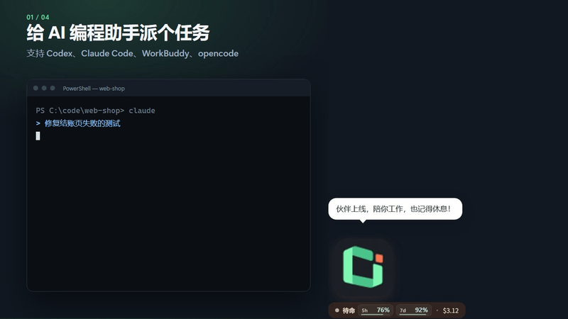
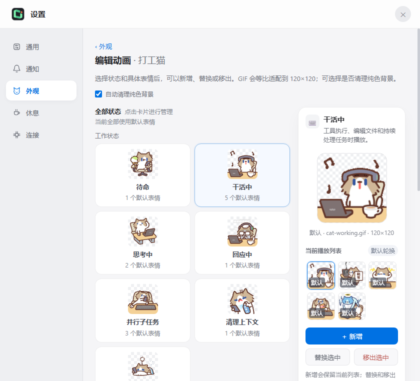
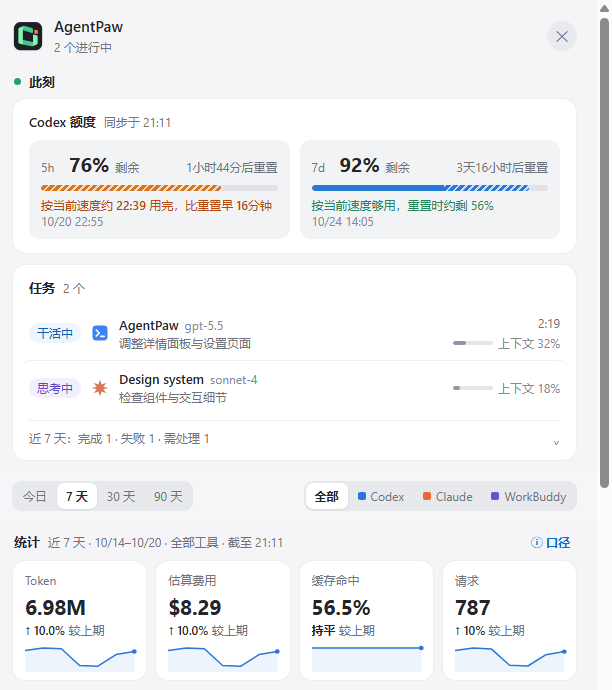

<div align="center">
  
  <h1>AgentPaw</h1>
  <p><strong>把你喜欢的 GIF 变成桌面伙伴，让 AI 编程任务和额度一眼可见。</strong></p>
  <p>Claude Code 要授权时它举手，Codex 额度和 token 用量随时看，<br>到点还提醒你喝口水——Windows 桌宠，任何 GIF 都能当角色。</p>
  <p>支持 <strong>Codex</strong> · <strong>Claude Code</strong> · <strong>WorkBuddy</strong> · <strong>opencode</strong></p>

  <p>
    <a href="https://github.com/vista-zhangg/agentpaw/releases/latest"></a>
  </p>
  <p>
    <a href="README.md">English</a> ·
    <a href="README_ZH_HANS.md">简体中文</a> ·
    <a href="README_ZH_HANT.md">繁體中文</a> ·
    <a href="README_FR.md">Français</a>
  </p>
  <p>
    <a href="https://github.com/vista-zhangg/agentpaw/actions/workflows/ci.yml"></a>
    
    <a href="LICENSE"></a>
    
  </p>
</div>

<p align="center"><br>
<sub>演示使用以 AgentPaw 图标制作的角色包；内置角色和你自己的 GIF 效果相同。</sub></p>

<table>
  <tr>
    <td align="center" valign="bottom" width="33%"><br><sub><strong>快速视图</strong>：点一下伙伴</sub></td>
    <td align="center" valign="bottom" width="33%"><br><sub><strong>就地授权</strong>：Enter 允许</sub></td>
    <td align="center" valign="bottom" width="33%"><br><sub><strong>Codex 额度</strong>：含用完预测</sub></td>
  </tr>
</table>

## 为什么用 AgentPaw

- **不用再盯着终端。** AI 干活时它也在忙，需要你时举手，一轮结束时提醒。四个工具的多个会话汇聚在同一处。
- **不切窗口就能授权。** 直接在桌宠上允许或拒绝 Claude Code 的请求；方案以 Markdown 排版显示，看完再批准或附意见退回。
- **额度用完前就知道。** Codex 5h / 7d 剩余额度、重置时间和用完预测，不用打开 Codex；所有工具的 token、缓存与费用统计都在一起。
- **做成你自己的伙伴。** 内置四个角色，也可以用任何 GIF 创建新角色；工作、思考、等待、完成、出错、睡觉等每个状态都能配自己的动画。

它也照顾你：喝水、伸展和远眺提醒按你使用电脑的时间计算，与 AI 是否在运行无关。

## 30 秒上手

1. 从[最新 Release](https://github.com/vista-zhangg/agentpaw/releases/latest) 下载 `AgentPaw-<version>-Windows-x64.exe` 并运行。
2. 安装包暂未做商业代码签名。若出现 SmartScreen 提示，点 **更多信息 → 仍要运行**。
3. 完成。AgentPaw 会自动识别你已经在用的工具并接入，无需配置；之后可在应用内直接更新。
4. 想先看看效果？右键桌宠，选“演示一遍”。

> [!NOTE]
> AgentPaw 当前**仅支持 Windows x64**，不支持 macOS、Linux 或 Windows on ARM。应用界面支持 English、简体中文、繁體中文。

## 角色

内置 **打工猫、奶茶鼠、小蜜蜂蜜蜜与线条小狗**，也支持你自己的原创 IP。仅奶茶鼠就有 83 张动图，覆盖 16 个状态，包括睡觉、犯困和哈欠。

| 打工猫 · 工作中 | 奶茶鼠 · 工作中 | 小蜜蜂蜜蜜 · 打招呼 | 线条小狗 · 工作中 |
| --- | --- | --- | --- |
|  |  |  |  |

<table>
  <tr>
    <td align="center"><br><strong>工作中</strong><br><sub>工具正在执行</sub></td>
    <td align="center"><br><strong>思考中</strong><br><sub>模型正在推理</sub></td>
    <td align="center"><br><strong>并行任务</strong><br><sub>多条任务同时进行</sub></td>
    <td align="center"><br><strong>等待授权</strong><br><sub>需要你的决定</sub></td>
  </tr>
  <tr>
    <td align="center"><br><strong>任务完成</strong><br><sub>一轮工作已结束</sub></td>
    <td align="center"><br><strong>执行出错</strong><br><sub>会话需要关注</sub></td>
    <td align="center"><br><strong>工具间隙</strong><br><sub>等待下一步事件</sub></td>
    <td align="center"><br><strong>休息中</strong><br><sub>当前没有活跃任务</sub></td>
  </tr>
</table>

### 用你自己的 GIF

打开“设置”→“外观”，用一张待命 GIF 创建新角色，或[导入整套角色包](docs/character-packs.md)。每个状态都可以新增轮换动画、替换或移出选中项，也可一键恢复默认。

<p align="center"></p>

GIF 会统一适配为 120 × 120 画布：透明背景原样保留，能安全识别时去掉与主体分离的纯色底；复杂背景不强行抠图。单个 GIF 上限 12 MB、2048 × 2048、180 帧、60 秒，每个状态最多 20 个自定义动画。AgentPaw 只把处理后的副本存到 `~/.agentpaw/pet-assets`，不会改动原始文件。自行导入素材的使用授权由用户负责。

## 用量一眼可见

<p align="center"></p>

详情面板汇总所有工具的 Token、缓存命中、上下文窗口、模型和参考金额，支持工具与周期筛选、按天与按小时图表、活跃时段和历史累计。金额按公开 API 单价估算，不等同于订阅账单。

<details>
<summary><strong>全部功能</strong></summary>

- **状态一眼可见**：工作、思考、并行、清理、等待授权、等待回复、完成、出错、摸鱼与睡眠；后台任务或定时唤醒未结束时保持运行，不提前报完成。
- **克制的提醒**：标准／仅需处理两档；连续完成合并提示，短暂失败恢复后不再弹出；可按 Agent 或项目静音，权限卡仍保留。
- **快速视图**：需要你的事项（可就地允许）、进行中的任务（模型、耗时、上下文占比）、最近会话与近 7 天记录；完成的任务在你打开前一直标在胶囊上；可就地关注、改名或静音项目。
- **Claude Code 订阅额度（可选）**：在设置“连接”中开启后，详情面板、快速视图和托盘菜单显示 Pro / Max 的 5h / 7d 额度。数据来自 Claude Code 官方的状态栏接口，因此只在终端运行 `claude` 时更新；Claude 桌面应用与 IDE 插件可能不运行状态栏，此时不会显示额度。你原有的状态栏照常显示。
- **托盘查额度**：右键托盘图标即可看脱敏账户、5h / 7d 剩余量、刷新点和更新时间；缺失窗口显示 `--`。
- **接入自检**：在设置中核对四个 Agent 的接入状态，一键修复或卸载。
- **隐私模式**：右键菜单一键开启，隐藏敏感明细，保留必要状态。
- **休息提醒**：喝水、伸展、远眺各自设间隔与稍后提醒，可今天跳过；可看今日使用时长、完成与跳过次数。
- **不打扰**：全屏时自动藏起，可安静 15 / 30 / 60 分钟或自定义时长；精简胶囊模式、贴边、可选全局快捷键（默认停用）、开机启动。

</details>

## 支持的工具

| Agent | 接入方式 | 是否修改外部配置 | 桌宠内授权 |
| --- | --- | --- | --- |
| Codex | 增量读取本机 rollout JSONL；官方 App Server 订阅额度通知 | 不修改 Codex 配置、不读取凭据文件 | 只读提醒 |
| Claude Code | `hook/agentpaw-hook.js` 生命周期 hook、transcript、进程信息 | 合并安装/卸载 AgentPaw hook，不覆盖已有 hook | 支持 |
| WorkBuddy | hook、transcript 与用量字段 | 仅在检测到 WorkBuddy 后合并安装 hook | 只读提醒 |
| opencode | 官方插件机制、事件与用量文件 | 安装/卸载一个独立插件文件 | 只读提醒 |

首次启动只接入当前 Windows 用户已经在用的工具，不会为未检测到的 Agent 创建配置目录。

## 数据与隐私

- 数据都留在本机：会话数据只在本机读取和处理，配置与用量台账保存在 `~/.agentpaw/`。
- 本地 HTTP 服务只监听 loopback，写接口要求每次运行随机生成的令牌。
- 唯一的下载是 models.dev 的公开价目表；transcript、权限内容和统计数据从不上传。
- Codex 额度通过 Codex 自己的 App Server 读取，认证由 Codex 负责；AgentPaw 不读取 `~/.codex/auth.json`，也不访问 ChatGPT 网页接口。
- Claude Code 订阅额度（默认关闭）只取自官方状态栏数据，不读取 Claude 的凭据。

完整说明见[隐私与数据边界](docs/PRIVACY.md)。

## 工作原理

```text
Claude hook ─────┐
Codex rollout ───┼──> local server / watcher ──> adapter / core ──> 桌宠 + 详情面板
WorkBuddy ───────┤
opencode 插件 ───┤
Codex App Server ───────> 托盘右键菜单（5h / 7d）+ 临界额度气泡
```

主进程负责 watcher 生命周期、托盘和窗口；后端状态机聚合多会话；renderer 只接收收敛后的状态与事件协议。状态词汇和优先级由 [`shared/states.js`](shared/states.js) 统一定义，见[状态机与渲染规范](STATES.md)。

## 文档

- [使用指南](docs/介绍.md)
- [角色包](docs/character-packs.md)
- [本地开发与打包](docs/LOCAL_DEPLOYMENT.md)
- [版本发布流程](docs/RELEASE.md)
- [贡献指南](CONTRIBUTING.md) · [安全策略](SECURITY.md)

## 项目来源与许可证

AgentPaw 是独立、免费、非营利的开源项目，与 OpenAI、Anthropic 无隶属关系。本项目基于 [LLMPET](https://github.com/myunwang/LLMPET) 二次开发，并在 Windows 桌面交互、多 Agent 接入、用量统计、设置与工程结构方面进行了扩展和重构。

- 源代码依照 [MIT License](LICENSE) 发布，根目录许可证保留上游 `Copyright (c) 2026 myunwang`。
- 第三方角色素材不适用代码的 MIT License，版权归各自创作者：奶茶鼠由 **阿翅 Achi** 创作，小蜜蜂蜜蜜由 **花栗鼠发发** 创作，线条小狗由 **Moonlab Studio** 创作。详见[角色署名总览](assets/CREDITS.md)，以及[打工猫](assets/cat/CREDITS.md)、[奶茶鼠](assets/characters/milktea-mouse/CREDITS.md)、[小蜜蜂蜜蜜](assets/characters/mimi-bee/CREDITS.md)、[线条小狗](assets/characters/line-dog/CREDITS.md)的素材说明。不销售角色，也不提供付费下载。

## 参与贡献

欢迎提交缺陷报告、Windows 兼容性改进、新 Agent 适配和角色包。提交前请先阅读 [CONTRIBUTING.md](CONTRIBUTING.md)，安全问题请按 [SECURITY.md](SECURITY.md) 私下报告。如果 AgentPaw 陪你写代码陪得还不错，点个 ⭐ 能让更多人发现它。
