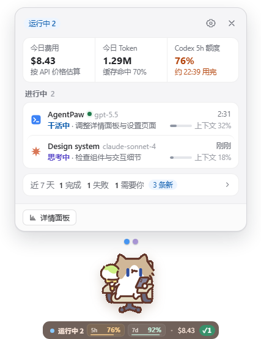
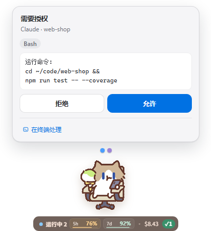
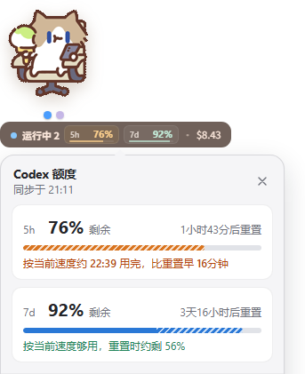

  
  <h1>AgentPaw</h1>
  
<strong>把你喜歡的 GIF 變成桌面夥伴，讓 AI 程式開發任務和額度一眼可見。</strong>

  
Claude Code 需要授權時它舉手，Codex 額度與 Token 用量隨時看， 時間到了還提醒你喝口水——Windows 桌寵，任何 GIF 都能當角色。

  
支援 <strong>Codex</strong> · <strong>Claude Code</strong> · <strong>WorkBuddy</strong> · <strong>opencode</strong>

  

    
  

  

    <a href="README.md">English</a> ·
    <a href="README_ZH_HANS.md">简体中文</a> ·
    <a href="README_ZH_HANT.md">繁體中文</a> ·
    <a href="README_FR.md">Français</a>
  

  

    
    
    
    
  

<table>
  <tr>
    <td align="center" valign="bottom" width="33%"> <strong>快速檢視</strong>：點一下夥伴</td>
    <td align="center" valign="bottom" width="33%"> <strong>就地授權</strong>：Enter 允許</td>
    <td align="center" valign="bottom" width="33%"> <strong>Codex 額度</strong>：含用完預測</td>
  </tr>
</table>

截圖為簡體中文介面；應用程式介面支援 English、简体中文與繁體中文。

## 為什麼用 AgentPaw

- **不用再盯著終端機。** AI 工作時它也在忙，需要你時舉手，一輪結束時提醒。四種工具的多個工作階段彙整在同一處。
- **不切視窗就能授權。** 直接在桌寵上允許或拒絕 Claude Code 的請求；方案以 Markdown 排版顯示，看完再批准或附意見退回。
- **額度用完前就知道。** Codex 5h / 7d 剩餘額度、重設時間與用完預測，不必開啟 Codex；所有工具的 Token、快取與費用統計都在一起。
- **做成你自己的夥伴。** 內建四個角色，也能用任何 GIF 建立新角色；每個狀態都能配自己的動畫。

它也照顧你：喝水、伸展與遠眺提醒依你使用電腦的時間計算，與 AI 是否在執行無關。

## 30 秒上手

1. 從[最新 Release](https://github.com/vista-zhangg/agentpaw/releases/latest) 下載 `AgentPaw-<version>-Windows-x64.exe` 並執行。
2. 安裝程式尚未進行商業程式碼簽章。若出現 SmartScreen 提示，點 **其他資訊 → 仍要執行**。
3. 完成。AgentPaw 會自動辨識你已在使用的工具並接入，無需設定；之後可在應用程式內直接更新。

> [!NOTE]
> AgentPaw 目前**僅支援 Windows x64**，不支援 macOS、Linux 或 Windows on ARM。

## 角色

內建打工貓、奶茶鼠、小蜜蜂蜜蜜與線條小狗。在「設定」→「外觀」中，可用一張待命 GIF 建立自己的角色，或匯入整套[角色包](docs/character-packs.md)；每個狀態都能新增輪換、替換或還原預設。

| 打工貓 · 工作中 | 奶茶鼠 · 工作中 | 小蜜蜂蜜蜜 · 打招呼 | 線條小狗 · 工作中 |
| --- | --- | --- | --- |
|  |  |  |  |

## 資料與隱私

資料都留在本機：工作階段資料只在本機讀取與處理，設定與用量紀錄保存在 `~/.agentpaw/`。唯一的下載是 models.dev 的公開價格表。Codex 額度透過 Codex 自己的 App Server 讀取，認證由 Codex 負責；AgentPaw 不讀取 `~/.codex/auth.json`。面板金額依公開 API 單價估算，不等同於訂閱帳單。完整說明見[隱私與資料邊界](docs/PRIVACY.md)。

## 授權、署名與貢獻

AgentPaw 是獨立、免費、非營利的開放原始碼專案，與 OpenAI、Anthropic 無隸屬關係。本專案基於 [LLMPET](https://github.com/myunwang/LLMPET) 二次開發，保留上游 MIT 授權與原始版權聲明，見 [LICENSE](LICENSE)。第三方角色素材不包含在程式碼的 MIT 授權內；原創作者、來源與使用範圍見[角色素材總覽](assets/CREDITS.md)、[打工貓](assets/cat/CREDITS.md)、[奶茶鼠](assets/characters/milktea-mouse/CREDITS.md)、[小蜜蜂蜜蜜](assets/characters/mimi-bee/CREDITS.md)及[線條小狗](assets/characters/line-dog/CREDITS.md)。自行匯入素材時，請確認使用授權。

歡迎透過 [Issues](https://github.com/vista-zhangg/agentpaw/issues) 回報問題，或依[貢獻指南](CONTRIBUTING.md)提交改進。詳細接入矩陣與工作原理請參閱[簡體中文 README](README_ZH_HANS.md)。
